# Raízes — Rastreabilidade Agrícola e Conformidade EUDR

**Código da Disciplina**: IBM8936<br>
**Turma**: PC_ADS_26.2_8001_II<br>
**Case**: 6 — AgTech: "Lavoura Inteligente"<br>

## Integrantes

| Nome |
| -- |
| Joao Vitor Donda |
| Caique Rechuan |
| Joao Gabriel Meirelles |

## Links

| O quê | Endereço |
| -- | -- |
| Frontend Raízes | <http://18.117.197.72:8000/> |
| API publicada (EC2) | <http://18.117.197.72:8000/api/> |
| Django Admin | <http://18.117.197.72:8000/admin/> |
| Documentação (MkDocs) | <https://projetos-de-extensao.github.io/PC_ADS_26.2_8001_II/> |

> Se a instância for parada e iniciada sem Elastic IP, o IP muda: atualize esta tabela.

## Sobre

A Raízes é uma plataforma de rastreabilidade agrícola. Ela consolida dados
de produtores, talhões, fontes ambientais (MapBiomas, DETER, Sentinel) e eventos de
recebimento e mantém um status de risco atualizado para cada talhão.

Quando um lote chega à cooperativa, a balança recebe **APROVADO**, **REVISÃO** ou
**BLOQUEADO**, com o motivo. A regulamentação europeia contra desmatamento (EUDR) é usada
como motivação de negócio, não como aconselhamento jurídico.

## Arquitetura da solução (Release 1 — AP2)

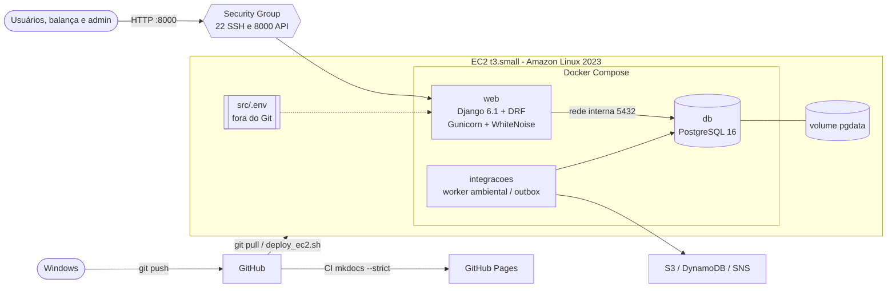

### Modelo de dados multimodelo (PostgreSQL)

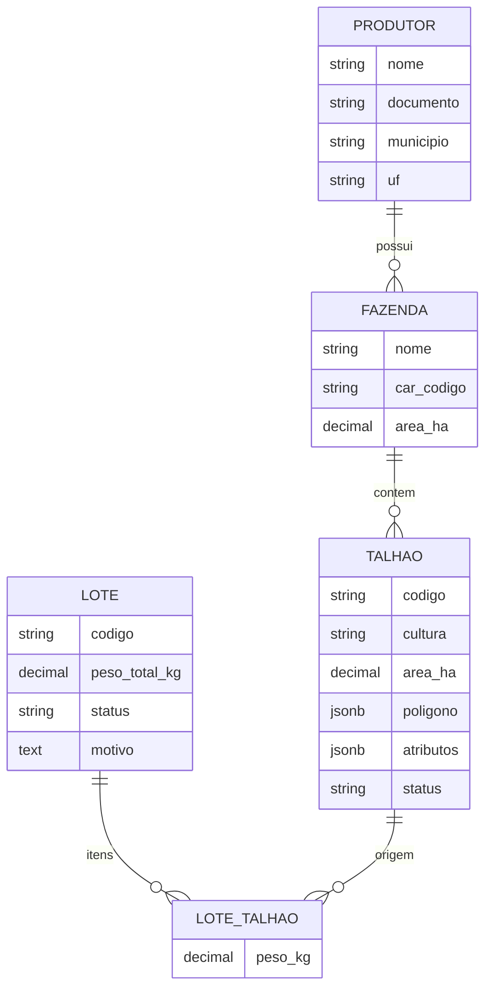

- **Relacional (ACID)**: Produtor → Fazenda → Talhão (FK) e Lote ↔ Talhão (ManyToMany com
  a tabela associativa `LoteTalhao`, que guarda o peso de cada origem).
- **Documento (JSONB)**: `Talhao.atributos` (bioma, NDVI, alertas, fonte, certificação),
  com **índice GIN** criado por migration, e `Talhao.poligono` (GeoJSON).
- **Transação**: `POST /api/lotes/receber/` grava o lote e os itens em
  `transaction.atomic()`. O lote assume o pior status dos talhões (RN-08), e uma soma de
  pesos divergente ou um talhão repetido desfaz tudo (409).

A arquitetura-alvo serverless (API Gateway, Lambda, DynamoDB, S3, Athena, EventBridge, SNS)
está no [Documento de Arquitetura](docs/Elaboracao/arquitetura.md).

## Frontend Raízes e monitoramento ambiental

Portal próprio: login, painel e mapa, produtores/fazendas/talhões, recebimento de lotes,
revisão com justificativa, vistorias, histórico e monitoramento ambiental INPE/DETER.
A interface fica na raiz `/` e usa Django, as APIs e sessões existentes.

Publicação e deploy autorizados pelo responsável em 11/11/2026. O endereço de implantação
é <http://18.117.197.72:8000/>. Utilize a conta administrativa existente da EC2.
Nenhuma senha de demonstração local é criada no servidor público.

O [guia do frontend](docs/Construcao/frontend_raizes.md) liga telas e requisitos.
O [guia de integrações](docs/Construcao/integracoes_aws_ambientais.md) descreve INPE/DETER,
S3, DynamoDB, SNS, fila persistente e limites. A suíte contém 80 testes.
O [guia de operação e simulação](docs/Construcao/guia_simulacao.md) explica toda a
infraestrutura e apresenta um roteiro. **Laboratório** oferece MapBiomas/Sentinel
sintéticos, seis cenários e voo/envio virtual retomável; **Relatórios** e **Como funciona**
completam a apresentação. Grupos Django aplicam os perfis funcionais no backend.
MapBiomas/Sentinel reais, perfis por cooperativa e ortomosaicos reais de 5 GB permanecem
na evolução de produção; não são necessários para executar o exercício acadêmico.

Consulte a [auditoria completa A1–A8, B1–B8 e Parte C](docs/Transicao/auditoria_roteiro_ap2.md) e as [regras de integridade e máscaras](docs/Construcao/integridade_validacoes.md).

## API

Leituras acadêmicas permanecem públicas; gravações exigem usuário ativo da equipe
(`is_staff`), com sessão/CSRF no navegador ou HTTP Basic nos exemplos de terminal.


| Recurso | Endpoint | Observação |
| -- | -- | -- |
| Produtores | `/api/produtores/` | CRUD; mostra fazendas e talhões aninhados |
| Fazendas | `/api/fazendas/` | CRUD; mostra talhões aninhados |
| Talhões | `/api/talhoes/` | CRUD; filtros `?atributos__chave=valor`, `?status=`, `?cultura=` |
| Lotes | `/api/lotes/` | CRUD e `POST /api/lotes/receber/` (transacional) |
| Itens do lote | `/api/lote-itens/` | CRUD da tabela associativa |

Exemplos:

```bash
curl "http://localhost:8000/api/talhoes/?atributos__bioma=cerrado"
curl "http://localhost:8000/api/talhoes/?atributos__ndvi__lt=0.5"
curl -G "http://localhost:8000/api/talhoes/" --data-urlencode 'atributos__contains={"fonte": "DETER"}'
curl --user "$RAIZES_USER:$RAIZES_PASSWORD" -X POST http://localhost:8000/api/lotes/receber/ -H "Content-Type: application/json" \
  -d '{"codigo": "2026-11-0001", "peso_total_kg": "300.00", "itens": [{"talhao": 1, "peso_kg": "200.00"}, {"talhao": 3, "peso_kg": "100.00"}]}'
```

## Execução local (Windows)

Pré-requisitos: Docker Desktop e Git.

```powershell
cd src
copy .env.example .env
```

Edite o `src\.env` (troque `SECRET_KEY` e as senhas; para testar localmente use
`ALLOWED_HOSTS=localhost,127.0.0.1`). Depois:

```powershell
docker compose up -d --build
docker compose exec web python manage.py test lavouraInteligente
```

A API fica em <http://localhost:8000/api/> e o admin em <http://localhost:8000/admin/>,
com o usuário e a senha definidos no `.env`. Com `SEED=1`, os dados de exemplo são
carregados ao subir.

## Deploy na EC2 (Amazon Linux 2023)

1. Crie a instância (t3.small recomendada) e um Security Group com entrada **TCP 22**
   (seu IP) e **TCP 8000** (0.0.0.0/0). **Não** libere a 5432.
2. Conecte por SSH e rode:

```bash
curl -fsSL https://raw.githubusercontent.com/Projetos-de-Extensao/PC_ADS_26.2_8001_II/main/scripts/deploy_ec2.sh | bash
```

O script instala Docker, Git, Compose e Buildx, clona ou atualiza o repositório, cria o
`src/.env` com segredos aleatórios (e mostra a senha do admin) e sobe `web` + `db` + `integracoes`.

**Atualizar** depois de um `git push` no Windows: rode o mesmo comando, ou
`bash ~/PC_ADS_26.2_8001_II/scripts/deploy_ec2.sh`.

**Backup**: `bash ~/PC_ADS_26.2_8001_II/scripts/backup_db.sh` (gera
`src/backups/*.sql.gz` com `pg_dump`). Restauração em
[dimrbd.md](docs/Elaboracao/dimrbd.md) (seção 5.2).

O passo a passo manual está em
[Deploy EC2 + Docker (PostgreSQL)](docs/Construcao/deploy_ec2_postgres.md), e o rollback em
[Estratégias de Deploy](docs/Transicao/ativ_deploy.md#7-plano-de-rollback).

## Validação e evidências da AP2 (B8)

**Registros de validação — 11/11/2026.** As capturas abaixo documentam a versão anterior ao novo deploy. Publicação e implantação do frontend e das integrações autorizadas pelo responsável. O guia de integrações separa as verificações atuais.

| Verificação | Resultado observado |
| -- | -- |
| Infraestrutura | t3.small, Amazon Linux 2023, us-east-2; disco real de 8 GiB |
| Docker/PostgreSQL | `db` healthy, porta 5432 interna; `web` na porta 8000 |
| API pública | CRUD dos cinco recursos, PUT/PATCH/DELETE, serializers aninhados e filtro JSON verificados |
| Transação | Recebimento 201; peso divergente e talhão repetido retornam 409, sem gravação parcial |
| Admin | Login real com CSRF e listagem de talhões verificados; estáticos acessíveis |
| Persistência | Mesmo registro, ID e conteúdo após `docker compose down` e `up -d` |
| Testes | 80 testes aprovados no Windows/PostgreSQL 18 e na EC2/PostgreSQL 16; integridade e migrations incluídas |
| Restore | Banco separado restaurado; contagens das cinco tabelas e índice GIN iguais ao original |
| Backup | Dump local e envio S3 por função IAM quando configurado; ver guia de integrações |
| Security Group | Console conferido em 12/11: `launch-wizard-2` somente TCP 22 e 8000; SSH ainda aceita qualquer origem IPv4 |

As imagens de comandos abaixo são **transcrições das saídas reais capturadas por SSH**, não screenshots simulando uma janela de terminal. As capturas da API e do Admin são identificadas separadamente.

### Containers e logs

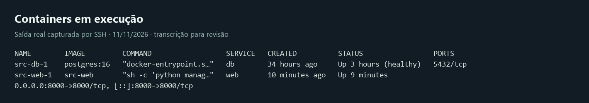
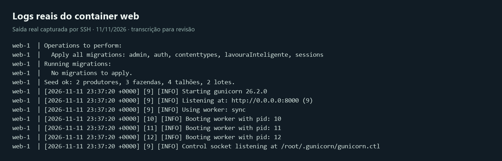

### API pública e Admin

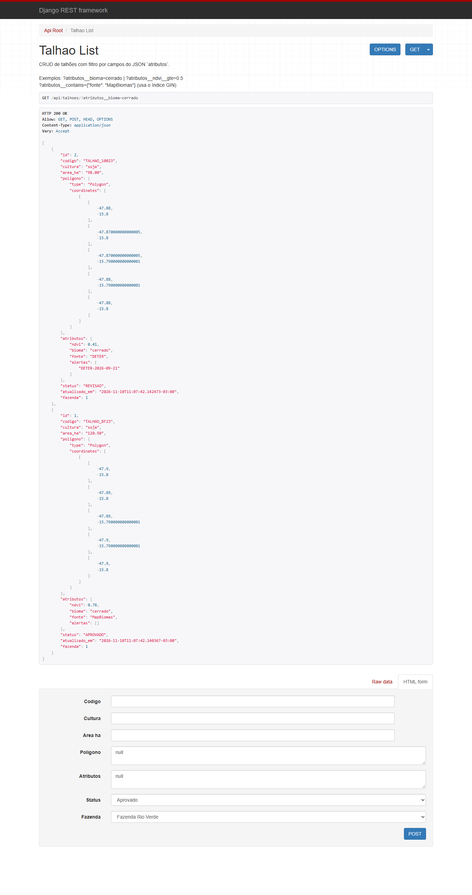
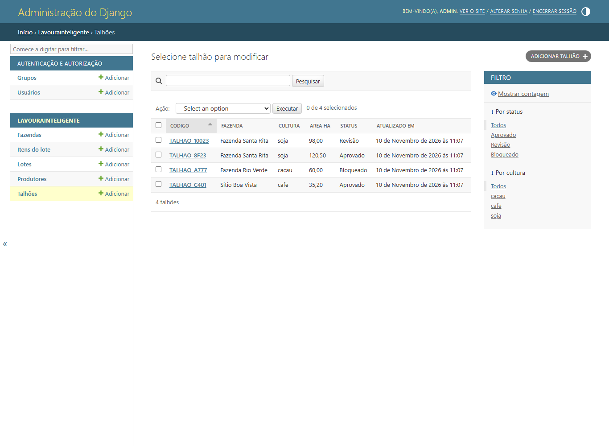

### PostgreSQL e persistência

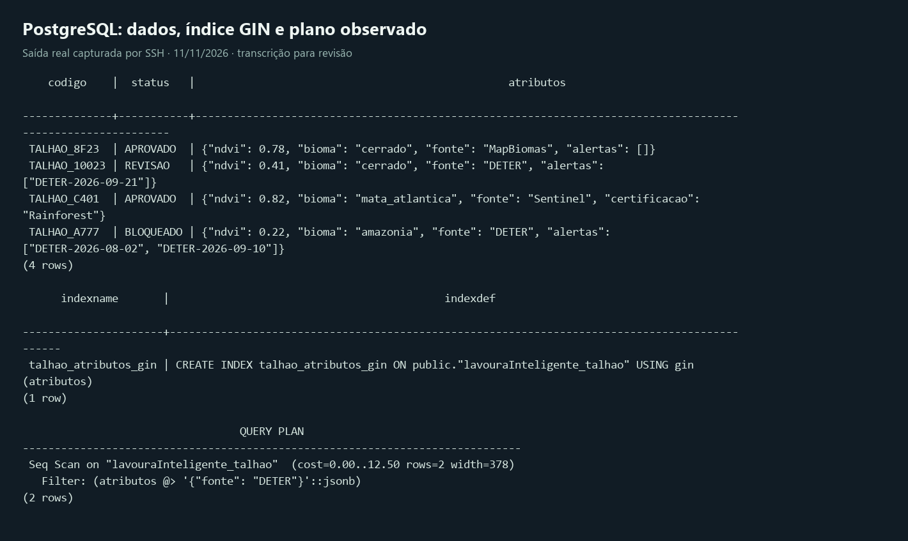
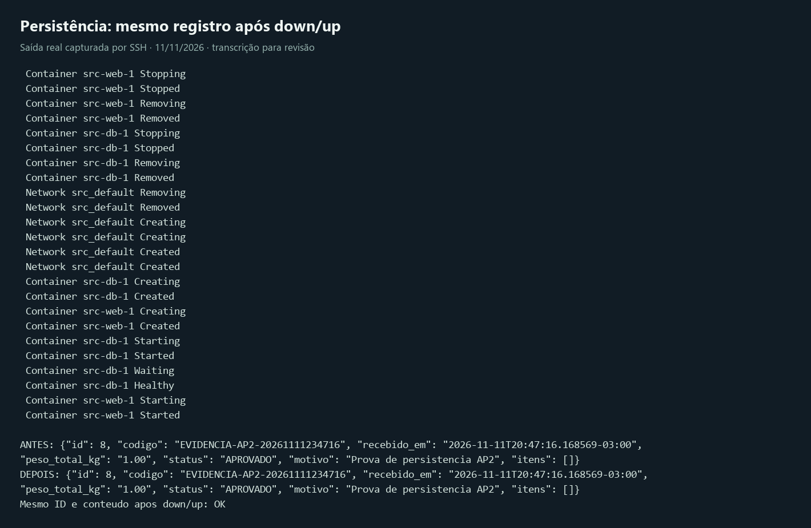

### Testes, backup e restauração

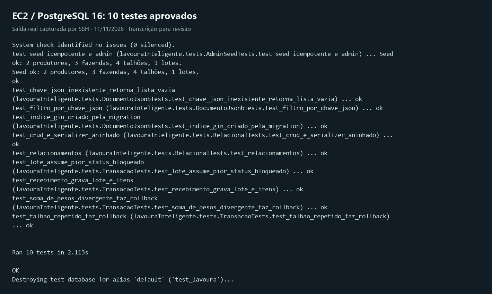
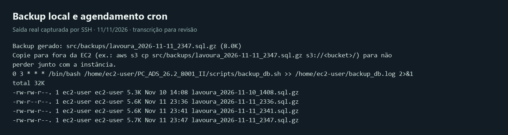
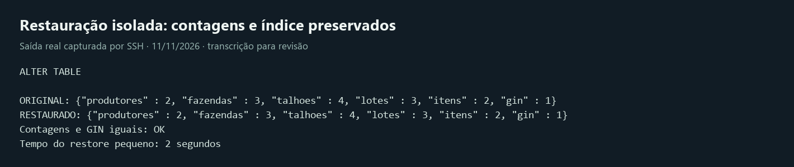

O [registro de validação](docs/Transicao/validacao_ap2.md) separa verificações concluídas, propostas locais e pendências da entrega. O console AWS foi conferido em 12/11: somente TCP 22 e 8000, sem 5432. Os detalhes atuais estão na auditoria do roteiro; as imagens abaixo são históricas.

## Documentação

| Fase | Documentos |
| -- | -- |
| Iniciação | [Documento de Visão](docs/Iniciacao/dv.md) · [Requisitos Suplementares](docs/Iniciacao/rs.md) |
| Elaboração | [Arquitetura](docs/Elaboracao/arquitetura.md) · [Requisitos Funcionais](docs/Elaboracao/levreq.md) · [Casos de Uso Arquiteturais](docs/Elaboracao/cua.md) · [Pacotes e Subsistemas](docs/Elaboracao/maps.md) · [Dimensionamento EC2](docs/Elaboracao/dim_comp.md) · [Dimensionamento do Banco](docs/Elaboracao/dimrbd.md) · [Sequência e Comunicação](docs/Elaboracao/seq_com.md) |
| Construção | [Deploy EC2 (SQLite)](docs/Construcao/deploy_ec2_sqlite.md) · [Deploy EC2 (PostgreSQL)](docs/Construcao/deploy_ec2_postgres.md) |
| Transição | [Estratégias de Deploy](docs/Transicao/ativ_deploy.md) |

Documentação local:

```bash
pip install -r requirements.txt
mkdocs build --strict
mkdocs serve
```

O pipeline valida o build estrito em pull requests e publica o site após mudanças na
branch `main`.
