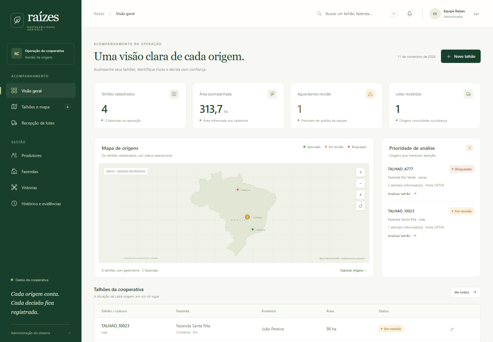
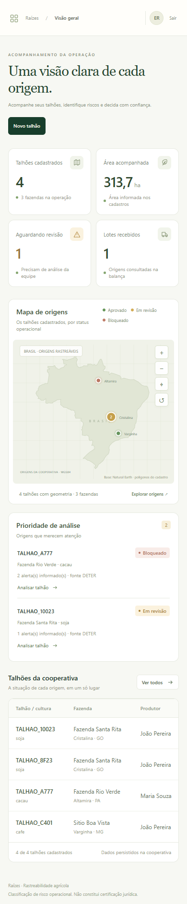

# Frontend operacional do Raízes

**Situação:** implementação testada; publicação e deploy autorizados em 11/11/2026.

A interface descrita pelos casos de uso é servida na raiz `/` pelo mesmo Django da
API. Ela possui telas próprias; o Django Admin permanece como ferramenta de
administração. HTML, CSS e JavaScript usam os endpoints existentes e novas ações
operacionais autenticadas. Não há uma segunda API nem um serviço de frontend pago.

## Prévia local com dados fictícios

As capturas mostram a proposta em execução no computador de revisão, antes de qualquer
deploy na EC2. Não são uma captura do sistema público atualmente implantado.





## Telas e rastreabilidade

| Tela | Fluxo implementado na proposta | Documentação de origem |
| -- | -- | -- |
| Entrar | Sessão Django, acesso à operação restrito a usuários ativos da equipe (`is_staff`), logout por POST | UC-FUN-001; RF-IDN-01 |
| Visão geral | Indicadores calculados dos registros, mapa das origens, talhões prioritários e lista de áreas | UC-FUN-009; RF-HIS-01 |
| Talhões e mapa | Mapa SVG local, agrupamento, zoom, seleção de áreas; filtros por produtor, município, status e busca; detalhes e atributos | UC-FUN-002/009; RF-CAD-01; RF-HIS-01 |
| Cadastro do talhão | Cadastro/edição, importação KML/GeoJSON, validações de formato, fechamento, coordenadas e limite de vértices | UC-FUN-003; RF-GEO-01/02, parcialmente |
| Produtores e fazendas | CRUD com relacionamentos e recusa da exclusão de cadastros com referências ativas | UC-FUN-002; RF-CAD-01 |
| Recepção de lotes | Distribuição do peso entre origens, recebimento transacional, resultado/motivo e rollback de pesos divergentes ou origem repetida | UC-FUN-006; RF-LOT-01/02/03; RN-08 |
| Decisão na balança | Aceitar/recusar com justificativa, operador, data e status consultado; decisão preservada; lote não aprovado ou sem origem não pode ser aceito | RF-LOT-04 |
| Revisão de status | Justificativa obrigatória, autor, antes/depois e snapshot da evidência original | UC-FUN-007; RF-RSK-05; RN-06 |
| Vistorias | Solicitação apenas para talhão em revisão; reutilização de solicitação aberta, agendamento e recepção de imagens | UC-FUN-011/012; RF-DRN-01/02, recepção parcial de RF-DRN-03 |
| Histórico e evidências | Filtros por texto, responsável e período, trilha de ações e exportação do registro de talhão/lote com manifesto SHA-256 | UC-FUN-009/010; RF-AUD-01, pacote operacional parcial de RF-AUD-02 |

O mapa usa o contorno público do Brasil (Natural Earth) e as geometrias cadastradas.
Os polígonos não são enviados a uma plataforma de mapas. Ele não exibe imagens de
satélite inventadas nem apresenta a digitação de um atributo como ingestão ambiental.

## Persistência e endpoints

A migration `0002` acrescenta `RevisaoStatus`, `DecisaoRecebimento`, `Vistoria`,
`ArquivoVistoria` e `EventoAuditoria`. As cinco entidades originais continuam com seus
nomes e relacionamentos.

| Endpoint | Uso |
| -- | -- |
| `/` e `/entrar/` | Interface e autenticação |
| `/app/estado/` | Dados autenticados para as telas |
| `/api/produtores/`, `/api/fazendas/`, `/api/talhoes/` | CRUD dos cadastros |
| `/api/lotes/receber/` | Recebimento atômico do lote e itens |
| `/app/talhoes/ID/revisar/` | Revisão com autoria e evidência preservada |
| `/app/lotes/ID/decisao/` | Decisão imutável do operador |
| `/app/talhoes/ID/vistoria/` | Solicitação idempotente de vistoria |
| `/app/vistorias/ID/status/` e `/app/vistorias/ID/arquivo/` | Agendamento e imagens |
| `/app/arquivos/ID/` | Download autenticado da imagem |
| `/app/exportar/talhao/ID/` e `/app/exportar/lote/ID/` | ZIP do registro com manifesto |

As ações `/app/` exigem sessão da equipe e proteção CSRF. A API CRUD permite leitura pública
e exige equipe autenticada para gravação. Ainda não implementa a matriz completa de perfis e escopos por produtor/cooperativa da arquitetura-alvo.

O Compose acrescenta um volume `media` para arquivos de vistoria. `media/` fica fora do
Git e da imagem de build. Cada imagem recebida possui tamanho, autor, data e hash.

## Limites que permanecem

- A recepção local aceita JPEG/PNG/TIFF íntegros de até 20 MB. O requisito-alvo de
  ortomosaicos de 5 GB com retomada depende de armazenamento e upload multipart.
- Receber uma imagem não aprova sua georreferência, data ou cobertura de 95%. Essa
  validação automática e a sobreposição GeoTIFF no mapa permanecem pendentes.
- A consulta real INPE/DETER e os adaptadores S3/DynamoDB/SNS estão descritos no
  [guia de integrações](integracoes_aws_ambientais.md). Cognito/MFA, Athena e PostGIS
  permanecem na arquitetura-alvo. Sessão Django e PostgreSQL atendem esta implantação.
- A validação de geometria cobre formato, fechamento, coordenadas e limite de vértices;
  validação topológica completa, áreas implausíveis, versionamento de cada edição e
  normalização PostGIS ainda não estão completos.
- A exportação reúne registros disponíveis nesta implantação. Não é o pacote completo
  de evidências versionadas por cinco anos nem uma certificação jurídica.
- A exclusão continua física quando permitida; retenção/exclusão lógica completa da
  RN-09 e controle multicooperativa exigem evolução adicional.

## Validação e execução

Os 80 testes automatizados cobrem também os contratos de autenticação, CSRF, revisão,
decisão, vistoria, arquivos e exportação. O roteiro de navegador verifica os fluxos com
um banco separado de QA. Nenhum desses testes altera o banco da EC2.

Para executar no ambiente Docker já documentado:

```bash
cd src
docker compose up -d --build
docker compose exec -T web python manage.py test lavouraInteligente
```

O bootstrap aplica as migrations `0002` e `0003`, cria o administrador pelas variáveis existentes
e coleta os estáticos. Após um deploy aprovado, a interface fica na porta 8000, na
raiz `/`, e a API permanece em `/api/`. O deploy preserva o volume PostgreSQL e deve ser precedido de backup.

A tela **Monitoramento ambiental** consulta INPE/DETER, registra resultado e validade,
permite baixar snapshots e apresenta a fila AWS. Alertas aparecem tracejados no mapa
quando há zoom suficiente.

## Laboratório e guia de apresentação

**Laboratório** acrescenta seis cenários sintéticos, voo virtual com cobertura/data e
envio em partes retomável, preservado pela migration `0004`. **Relatórios** agrupa os
dados e exibe a outbox; **Como funciona** explica operação, infraestrutura atual e os
serviços da arquitetura-alvo. O [guia completo](guia_simulacao.md) fornece um roteiro.
Os perfis são aplicados no servidor e refletidos nos controles visíveis.
O limite convencional de imagem continua 20 MB; os 5 GiB do laboratório são metadados
de um exercício virtual, sem transferência de arquivo desse tamanho.
