# Guia do Raízes: operação, simulação e infraestrutura

O Raízes é uma demonstração acadêmica de rastreabilidade agrícola: uma cooperativa
precisa saber **de qual área veio uma carga**, quais riscos estão associados à origem
e quem tomou a decisão de recebê-la. Os cadastros de exemplo são fictícios.

O portal é publicado em <http://18.117.197.72:8000/>. **Laboratório**, **Relatórios**
e **Como funciona** aparecem no menu após entrar com uma conta autorizada.
As credenciais permanecem privadas e não fazem parte deste guia ou do GitHub.

## 1. Infraestrutura que existe agora

[Fonte do diagrama](../assets/diagramas/infraestrutura_atual.mmd)

| Camada | O que faz no projeto |
| -- | -- |
| Navegador | Mostra HTML/CSS/JavaScript e envia formulários. O mapa SVG representa os polígonos cadastrados; não é fotografia de satélite. |
| EC2 | Computador virtual Amazon Linux na AWS. A instância atual é t3.small; o disco EBS é de 8 GiB. |
| Docker Compose | Mantém três containers: `web`, `db` e `integracoes`. Uma atualização recria o código da aplicação e preserva os volumes. |
| Gunicorn | Recebe as requisições HTTP na porta 8000 e executa o Django. |
| Django + DRF | Autenticação, autorização por perfil, regras de negócio, templates e APIs JSON. WhiteNoise entrega os arquivos estáticos. |
| PostgreSQL 16 | Fonte de verdade para cadastros, geometrias JSONB, lotes, análises, vistorias, decisões, histórico e fila de entregas. A porta 5432 é interna ao Compose. |
| Volumes | `pgdata` guarda o banco; `media` guarda as imagens realmente enviadas nas vistorias convencionais. Recriar o container não apaga esses volumes. |
| Worker `integracoes` | Reconsulta áreas operacionais após 24 horas e tenta entregar eventos à AWS a cada minuto. Os cenários virtuais ficam fora da consulta real do INPE. |
| S3 | Armazena snapshots ambientais, versões de polígono e auditoria em JSON, com bucket privado, criptografia e versionamento. Os cenários usam o prefixo `demonstracao/`. |
| DynamoDB | Recebe uma projeção de status. Chaves de simulação usam `DEMO#TALHAO#id`; as demais usam `TALHAO#id`. A balança desta versão continua consultando PostgreSQL. |
| SNS | Recebe publicações de mudanças de risco. Não foram criados destinatários automáticos de e-mail ou SMS. Publicar um evento não significa que uma pessoa recebeu uma mensagem. |
| IAM | A função associada à EC2 permite acessar somente os recursos necessários da aplicação, com credenciais temporárias. Não há chaves AWS no código. |
| GitHub | Guarda código e documentação. Actions executa testes e valida o MkDocs; GitHub Pages publica os documentos. O deploy da EC2 faz `git pull`, build e recriação dos containers. |

A AWS descreve a EC2 como infraestrutura de computação virtual no
[guia oficial](https://docs.aws.amazon.com/AWSEC2/latest/UserGuide/concepts.html).
O significado de versionamento S3 está no
[guia de versões de objetos](https://docs.aws.amazon.com/AmazonS3/latest/userguide/Versioning.html).
Versionamento, sozinho, não equivale a Object Lock ou retenção legal de cinco anos.

## 2. O caminho de uma operação

1. **Cadastre a origem:** um produtor possui fazendas; cada fazenda possui talhões.
   O talhão é uma área delimitada por um polígono GeoJSON, com cultura e área em hectares.
2. **Analise a área:** a consulta real cruza o polígono com alertas públicos INPE/DETER.
   O laboratório exercita os papéis de DETER, MapBiomas e Sentinel com dados sintéticos.
3. **Calcule o risco:** interseção com alerta de desmatamento posterior ao corte leva
   a bloqueio; proximidade ou falta de informação leva a revisão. O resultado registra
   motivo, fontes, hash do polígono e validade.
4. **Resolva a dúvida:** uma origem em revisão pode receber uma vistoria. No exercício,
   um voo virtual deve ter georreferência, data compatível e cobertura de pelo menos 95%.
   Um voo válido habilita a revisão humana; não aprova o talhão automaticamente.
5. **Receba a carga:** o operador informa o peso total e o distribui entre os talhões.
   O lote recebe o pior status entre as origens. Peso divergente ou origem repetida
   faz a transação inteira voltar atrás, sem salvar metade do recebimento.
6. **Registre a decisão:** aceitar exige origens aprovadas e válidas no momento da
   decisão. Um alerta novo, análise vencida ou polígono alterado impede a aceitação.
   Lotes com decisão e seus itens são preservados contra alteração pela API.
7. **Exporte o dossiê:** um ZIP reúne registro, geometrias, análises, datasets, auditoria
   e metadados dos voos virtuais disponíveis, com SHA-256 por arquivo.

O índice GIN permite indexar os atributos JSONB. Isso não garante que o otimizador
use o índice em toda consulta. `transaction.atomic()` coordena a gravação do lote e
dos itens. As regras e o PostgreSQL são efetivos; os dados de laboratório são fictícios.

## 3. Laboratório: o que é real e o que é simulado

| Elemento | Natureza |
| -- | -- |
| Login, perfis, cadastros, transações, validação espacial e persistência | Código e banco reais |
| Consultas INPE/DETER em Monitoramento ambiental | Requisições reais a fonte pública |
| Fontes citadas dentro de um cenário do Laboratório | Dados sintéticos, sem chamada às APIs de MapBiomas/Sentinel/DETER |
| NDVI do cenário | Calculado a partir de valores sintéticos de bandas NIR e vermelho |
| Voo virtual | Área coberta e data geradas para testar a regra; não existe captura física |
| Desenho da cobertura | SVG esquemático, identificado como simulação; não é fotografia nem ortomosaico real |
| Envio virtual de 5 GiB | Dez partes representadas por metadados persistidos; zero bytes de imagem transferidos |
| Evidências S3, projeções DynamoDB e publicações SNS | Integrações AWS reais, com conteúdo fictício identificado quando aplicável |

Os cenários não alteram os quatro talhões originais do seed. Criam talhões `DEMO-*`
vinculados a um produtor e fazenda virtuais. A marca de simulação é gerenciada pelo
servidor; a API comum não permite forjá-la. A balança recusa misturar origens do
laboratório com origens operacionais no mesmo lote.

O NDVI é `(NIR − vermelho) / (NIR + vermelho)`, conforme a
[definição do USGS](https://www.usgs.gov/landsat-missions/landsat-normalized-difference-vegetation-index).
No exercício, NIR=0,8 e vermelho=0,1 resultam em aproximadamente 0,7778. Esse indicador
não elimina, por si só, uma evidência de desmatamento após a data de corte.

### Cenários disponíveis

| Cenário | Resultado esperado | O que demonstra |
| -- | -- | -- |
| Área sem alertas | APROVADO, somente no exercício sintético completo | Caminho favorável para recebimento |
| Alerta próximo | REVISÃO | Distância menor que 100 m sem interseção |
| Interseção com desmatamento | BLOQUEADO | Interseção e corte temporal |
| Imagem com nuvens | REVISÃO | Informação óptica insuficiente |
| Fonte indisponível | REVISÃO | Falha de integração sem falsa aprovação |
| Análise vencida | REVISÃO | Validade expirada exige nova avaliação |

Na consulta real, a ausência de alertas DETER permanece em revisão enquanto a cobertura
das demais fontes não estiver completa. O laboratório pode aprovar um cenário sintético
completo; isso não é aprovação ambiental de uma propriedade real.

### Voo e envio retomável

1. Abra um cenário em revisão e escolha o tipo de voo.
2. Envie as próximas três partes. Recarregue a página: as partes continuam registradas.
3. Retome o restante; também é possível pausar ou cancelar.
4. Valide o voo. Cobertura de 60%, data antiga e ausência de georreferência são rejeitadas.
5. Um voo com cobertura de 98% e data válida fica apto para revisão. O analista ainda
   deve registrar uma justificativa antes de aprovar a origem.

Cada parte tem um hash de seus metadados. A repetição da mesma parte não duplica a
gravação. O manifesto final também tem SHA-256. Esses hashes comprovam integridade dos
metadados do exercício; não são prova de integridade de uma imagem inexistente.
O tamanho declarado de 5 GiB não prova capacidade, throughput ou transferência real
desse volume. A validação usa um polígono de cobertura; não lê cabeçalhos GeoTIFF reais.

## 4. Perfis

Os grupos são criados por `python manage.py configurar_perfis`; nenhum usuário ou senha
é criado por esse comando. No Django Admin, o administrador marca o usuário como membro
da equipe e atribui um dos grupos. As permissões são verificadas no backend e refletidas
nos botões; ocultar um botão não é a proteção de segurança.

| Grupo | Capacidades |
| -- | -- |
| Gestor | Todas as ações da operação |
| Analista | Cadastros, análises, solicitação de vistoria, revisão, laboratório e exportações |
| Operador da balança | Recebimento e decisão; consultas |
| Piloto | Agendamento, upload convencional, voo/envio virtual; consultas |
| Auditor | Consultas e exportações |

O superusuário mantém acesso administrativo. Contas de equipe antigas sem grupos
preservam acesso amplo por compatibilidade. Esta demonstração representa uma cooperativa;
não implementa segregação multicooperativa ou MFA. Consulte o
[sistema de autenticação Django](https://docs.djangoproject.com/en/6.1/topics/auth/default/).

## 5. A fila e as falhas

Uma alteração e sua intenção de envio são gravadas juntas no PostgreSQL. O worker lê
os eventos pendentes e envia depois. Se a AWS falhar, a linha continua na fila para
nova tentativa; o cadastro não desaparece. A projeção DynamoDB usa uma versão para
impedir que um retry antigo substitua o status mais recente.

Uma entrega SNS Standard pode ser duplicada. Um consumidor futuro deve deduplicar pelo
identificador do evento. Um envio marcado como concluído comprova a resposta do serviço,
não a leitura por um usuário. Em **Relatórios**, a fila mostra destino, tentativas e estado.

O PostgreSQL e a EC2 continuam sendo pontos únicos de falha. O protótipo não comprova
alta disponibilidade, SLA de 99,9%, 25 mil talhões ou RPO/RTO de produção.

## 6. Arquitetura-alvo e equivalentes nesta demonstração

| Serviço da documentação | Papel | Implementação atual |
| -- | -- | -- |
| API Gateway | Entrada das APIs | URLs Django/DRF |
| Lambda | Processamento das regras | Funções Python no web/worker |
| EventBridge | Agendamento e eventos | Loop do worker + outbox |
| RDS/PostGIS | Dados relacionais e geoespaciais gerenciados | PostgreSQL em Docker + Shapely/PROJ |
| Cognito/MFA | Identidade e autenticação reforçada | Sessões e grupos Django; sem MFA |
| Athena/Parquet | Análise do histórico S3 | SQL no PostgreSQL e exportação CSV; S3 guarda JSON |
| S3/DynamoDB/SNS | Evidências, projeções e eventos | Serviços efetivamente provisionados |

Equivalência de papel no exercício não significa que o serviço AWS foi criado. Não
foi necessário acrescentar RDS, NAT Gateway, balanceador ou outros serviços cobrados
para demonstrar estes fluxos. A arquitetura-alvo original continua documentada.

## 7. Roteiro de apresentação

1. Abra **Como funciona** e explique a pergunta de negócio: origem da carga e risco.
2. No **Laboratório**, execute **Área sem alertas**. Mostre a marca de simulação, as
   três fontes sintéticas e a aprovação restrita ao exercício.
3. Na **Recepção de lotes**, escolha apenas o talhão `DEMO-*` aprovado e distribua o peso.
   Crie outro lote com peso divergente para mostrar o rollback.
4. Execute **Alerta próximo**. Mostre o alerta no mapa e o resultado em revisão.
5. Faça primeiro um voo de cobertura insuficiente e mostre a rejeição. Depois faça
   um voo válido; envie três partes, recarregue, retome e valide.
6. Registre a revisão com justificativa e mostre a trilha em **Histórico e evidências**.
7. Execute **Interseção com desmatamento** e demonstre a recusa do lote bloqueado.
8. Abra **Relatórios**, confira a fila AWS e baixe CSV e dossiê ZIP com hashes.

## 8. Publicação, backup e segurança

O `.env` permanece privado; hosts, senhas e nomes dos recursos são configuração de
ambiente. O código não guarda chaves AWS. O endereço acadêmico atual usa HTTP, sem
TLS no portal, e leituras da API continuam públicas. Use dados fictícios e substitua
credenciais de demonstração antes de qualquer uso com dados reais.

O cron diário mantém dumps locais. Foi autorizada uma única cópia ao S3, restaurada
em banco separado para conferência. A recorrência de backups S3 permanece desativada,
conforme escolha do responsável. Nunca use `docker compose down -v` para atualizar.

A migration `0004` acrescenta cenários e uploads virtuais. Para preparar exemplos
uma única vez: `docker compose exec -T web python manage.py seed_laboratorio`.
Os exemplos são idempotentes; o comando não redefine cenários já usados.

80 testes validam domínio, autenticação/CSRF, perfis, simulação, separação de ambientes,
retomada de partes, validação do voo, dossiê e integrações. A validação visual percorre
os fluxos em banco de QA separado antes do deploy.
