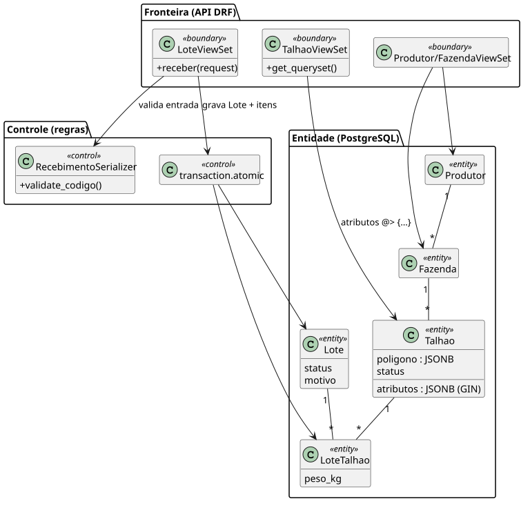

# Modelo de Análise — Dimensionamento de Computação (EC2) (v1.0)

**Projeto**: Raízes — Rastreabilidade Agrícola e Conformidade EUDR 
**Fase**: Elaboração 
**Release**: 1 (AP2) — EC2 + Docker Compose + PostgreSQL 
**Status**: Em revisão

## 1. Objetivo

Definir o tipo de instância EC2 que executa, na mesma máquina, os containers **web**
(Django + Gunicorn), **db** (PostgreSQL 16) e **integracoes** (worker) da Release 1, com base no cenário de
referência do [Documento de Requisitos Suplementares](../Iniciacao/rs.md) e em medições
feitas com a própria aplicação.

## 2. Carga de referência

| Item | Valor | Origem |
| -- | -- | -- |
| Produtores / talhões | 3.000 / 25.000 | rs.md, seção 2 |
| Consultas na balança | até 5.000 por dia; pico de 20 req/s por 30 min | RNF-CAP-02 |
| Tempo de resposta da balança | p95 < 500 ms | RNF-PER-01 |
| Usuários simultâneos no admin/painel | até 10 | estimativa da equipe |
| Crescimento | 2x talhões sem mudança estrutural | RNF-CAP-01 |

## 3. Classes de análise da Release 1

As classes abaixo são as que consomem CPU e memória em cada requisição. Elas
correspondem aos models, serializers e views do app Django `lavouraInteligente`.

[Fonte PlantUML](../assets/diagramas/dim_comp_classes.puml)

| Classe | Operação crítica | Custo dominante |
| -- | -- | -- |
| `LoteViewSet.receber` | 1 INSERT de lote + N (SELECT FOR UPDATE + INSERT) + 1 UPDATE numa transação | I/O do Postgres (commit) |
| `TalhaoViewSet` | consulta por chave JSON com índice GIN | CPU do Postgres + serialização JSON |
| `ProdutorViewSet` | serializer aninhado (produtor → fazendas → talhões) com `prefetch_related` | CPU do Gunicorn (serialização) |
| `bootstrap` (deploy) | `collectstatic` + `migrate` + seed | executa só na subida do container |

## 4. Medições com a aplicação

Verificação de 11/11/2026 na EC2 t3.small, com o seed e registros de demonstração:

| Medida | Resultado e limite |
| -- | -- |
| Memória `web` (3 workers, versão histórica) | 141,9 MiB em uma amostra de `docker stats`, sem carga sustentada |
| Memória `db` | 55,7 MiB na mesma amostra |
| 20 GETs externos sequenciais em `/api/talhoes/` | p50 310,3 ms; p95 339,6 ms, incluindo rede do cliente Windows |
| JSONB/GIN | Índice criado e testado; o plano efetivo fica no registro SQL da validação. Não se garante uso do GIN em toda consulta. |
| Disco efetivo | Sistema de arquivos raiz de 8 GiB; após limpeza de caches de instalação, cerca de 699 MiB livres antes do novo build |

As antigas referências de 49 ms e plano GIN não possuíam artefato reproduzível nesta revisão e não são usadas como prova. Esta amostra não comprova 20 req/s por 30 minutos nem a volumetria-alvo. O volume de 30 GB da seção seguinte é uma **recomendação**, diferente dos 8 GiB efetivamente encontrados.

Amostra atual de 12/11/2026, sem carga sustentada: web **174,2 MiB**, db **61,19 MiB**, integracoes **88,96 MiB**; disco livre **2,1 GiB**. A medição anterior acima é mantida como histórico.

## 5. Memória de cálculo

| Componente | Memória estimada | Base |
| -- | -- | -- |
| Amazon Linux 2023 + Docker Engine | ~400 MiB | sistema operacional e daemon |
| `web`: Gunicorn, 2 workers e 2 threads | ~150 MiB (medido) → até 300 MiB sob carga | ~50–100 MiB por worker |
| `db`: PostgreSQL 16 | 52 MiB ocioso → ~400 MiB com `shared_buffers` 128 MiB, cache e 20 conexões | padrão da imagem oficial |
| `integracoes`: processo Python de integração | ~90 MiB ocioso → até 250 MiB durante geoprocessamento | amostra atual e folga estimada |
| Folga para `docker compose build` (pip install) | ~300 MiB | pico só durante o deploy |
| **Total no pico** | **~1,65 GiB** | |

**Throughput**: a quantidade de workers não permitem deduzir a capacidade sem um teste concorrente. O cenário de 20 req/s por 30 min permanece uma meta de validação, e não uma medição realizada.

**Workers**: a regra usual é `2 × vCPU + 1`. Na t3.small isso daria 5 workers, mas a
versão atual usa 2 workers com 2 threads (`--workers 2 --threads 2`) e um worker de integrações separado para preservar memória.

## 6. Escolha da instância

| Tipo | vCPU | Memória | Preço on-demand* | Avaliação |
| -- | -- | -- | -- | -- |
| t3.micro | 2 | 1 GiB | ~US$ 7,59/mês | Funciona para demonstração, mas o pico estimado de ~1,65 GiB exige swap e o build fica lento. |
| **t3.small** | **2** | **2 GiB** | **~US$ 15,18/mês** | **Escolhida**: atende ao pico com folga estimada de ~350 MiB e créditos de CPU suficientes para a balança. |
| t3.medium | 2 | 4 GiB | ~US$ 30,37/mês | Indicada se o teste de carga mostrar falta de memória ou para 2x talhões com muitos usuários. |

\* Região us-east-2 (Ohio), Linux, 730 h/mês. São valores de referência que devem ser
conferidos no AWS Pricing Calculator na data da entrega (RNF-CUS-04).

**Decisão**: **t3.small**, com disco efetivo de 8 GiB; recomenda-se EBS gp3 de 30 GB (ver
[Dimensionamento de Banco de Dados](dimrbd.md)). Se a equipe usar uma t3.micro do Free
Tier na demonstração, deve criar 1 GiB de swap antes do primeiro build.

## 7. Escalabilidade e limites da Release 1

- **Vertical**: trocar o tipo da instância (t3.small → t3.medium) exige parar e iniciar a
  instância. Com Elastic IP o endereço da API não muda.
- **Horizontal**: o Compose roda numa única máquina. Escalar o `web` em várias instâncias
  exige tirar o banco da EC2 (RDS) e colocar um balanceador, o que é a evolução prevista
  em [Estratégias de Deploy](../Transicao/ativ_deploy.md).
- **Ponto único de falha**: web e db na mesma instância. A disponibilidade alvo da Release 1
  é menor que a da arquitetura final (ver rs.md, seção 13).

## 8. Histórico e aprovação

| Versão | Data | Status | Descrição | Autor(es) |
| -- | -- | -- | -- | -- |
| 1.0 | 10/11/2026 | Em revisão | Dimensionamento da EC2 para web + db em Docker Compose (Release 1). | Equipe do projeto |

| Papel aprovador | Nome | Data | Decisão |
| -- | -- | -- | -- |
| Arquiteto de Soluções | Responsável a confirmar pela equipe | Não registrada | Pendente |
| Professor responsável | Jonh Carvalho | Não registrada | Pendente de avaliação |
