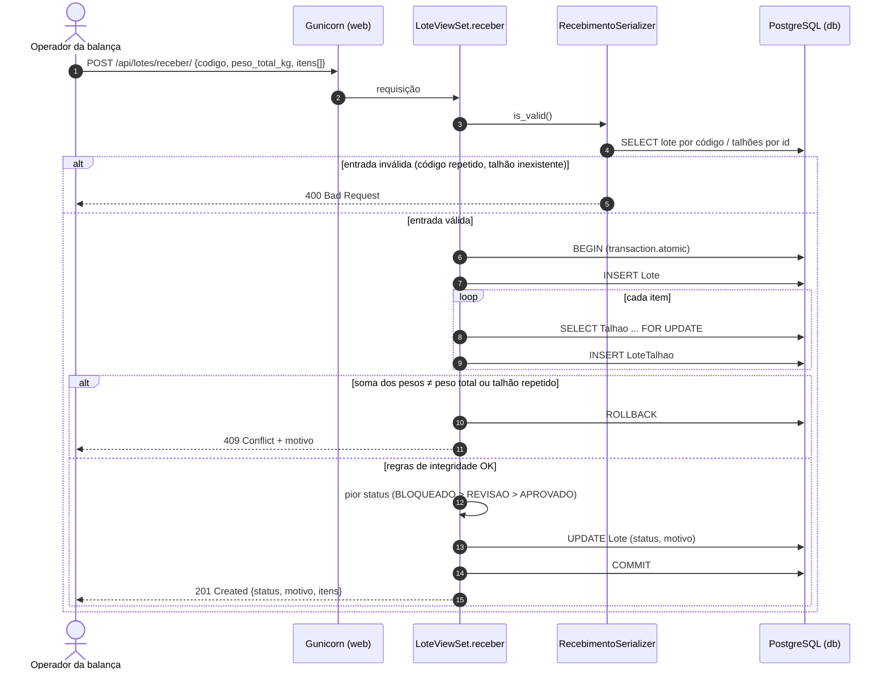
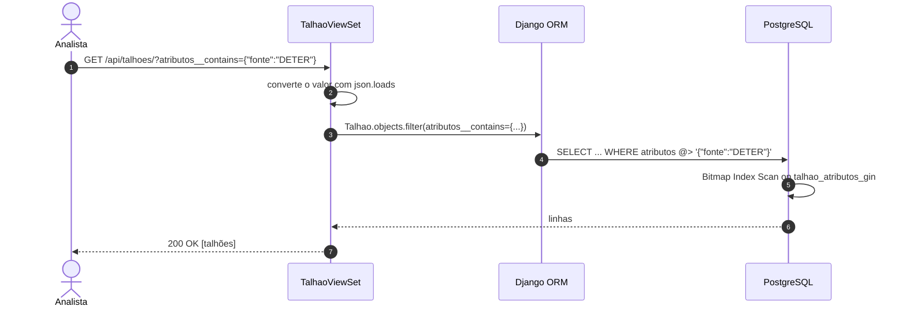
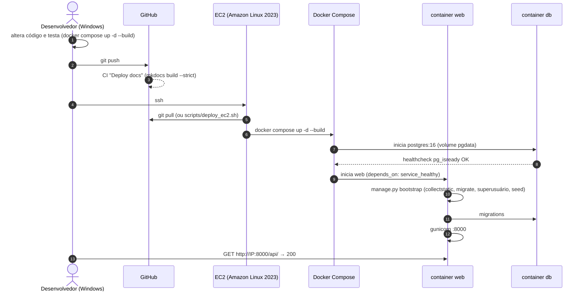
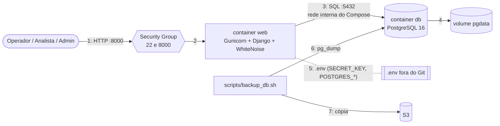

# Modelo de Design — Diagramas de Sequência e Comunicação (v1.0)

**Projeto**: Lavoura Inteligente — Rastreabilidade Agrícola e Conformidade EUDR 
**Fase**: Elaboração 
**Release**: 1 (AP2) — Django REST + PostgreSQL em Docker na EC2 
**Status**: Em revisão

## 1. Objetivo

Descrever os fluxos críticos da Release 1 (os objetos envolvidos e a ordem das
mensagens) e ligar cada requisito ao caso de uso, ao componente implementado e ao teste
ou evidência que o comprova.

## 2. Componentes participantes

| Componente | Implementação |
| -- | -- |
| Cliente | Balança, painel, Django Admin ou `curl` |
| Gunicorn | servidor WSGI no container `web` (porta 8000) |
| Router DRF | `conifg/urls.py` → `/api/produtores/`, `/api/fazendas/`, `/api/talhoes/`, `/api/lotes/`, `/api/lote-itens/` |
| `LoteViewSet` / `TalhaoViewSet` | `lavouraInteligente/views.py` |
| Serializers | `lavouraInteligente/serializers.py` |
| ORM / models | `lavouraInteligente/models.py` |
| PostgreSQL 16 | container `db`, volume `pgdata`, índice GIN `talhao_atributos_gin` |

## 3. Fluxo 1 — Recepção de lote na balança (transacional)

Endpoint: `POST /api/lotes/receber/`. Atende RF-LOT-01 a 04 e RN-08.

O `SELECT ... FOR UPDATE` trava os talhões durante a transação, para que uma revisão de
status simultânea não mude o talhão entre a leitura e a gravação do lote.

## 4. Fluxo 2 — Consulta de talhões por atributo JSON (documento)

Endpoint: `GET /api/talhoes/?atributos__<chave>=<valor>`. Atende RF-HIS-01 e o requisito
A3/A5 da AP2.

Também são aceitos caminhos e comparadores (`?atributos__bioma=cerrado`,
`?atributos__ndvi__lt=0.5`). Uma chave inexistente devolve lista vazia.

## 5. Fluxo 3 — Deploy (Windows → GitHub → EC2)

Atende B5 da AP2 e RNF-MAN-01/03.

## 6. Diagrama de comunicação (visão estrutural)

## 7. Matriz de rastreamento

| Requisito | Caso de uso | Componente | Teste / evidência |
| -- | -- | -- | -- |
| RF-CAD-01 (cadastro com relacionamentos) | UC-FUN-002 | `Produtor`, `Fazenda`, `Talhao`; `ProdutorViewSet`, `FazendaViewSet`, `TalhaoViewSet` | `RelacionalTests.test_crud_e_serializer_aninhado`, `test_relacionamentos` |
| RF-LOT-01 (lote com um ou mais talhões) | UC-FUN-006 | `Lote`, `LoteTalhao` (ManyToMany com peso) | `TransacaoTests.test_recebimento_grava_lote_e_itens` |
| RF-LOT-02 (status e motivo do lote) | UC-FUN-006 | `LoteViewSet.receber` | resposta 201 com `status` e `motivo`; print da API (README) |
| RF-LOT-03 / RN-08 (pior status) | UC-FUN-006 | `LoteViewSet.receber` | `TransacaoTests.test_lote_assume_pior_status_bloqueado` |
| RN-04 (talhão sem polígono não é APROVADO) | UC-FUN-005 | `LoteViewSet.receber` | revisão de código; seed com polígonos |
| A4 (transação com rollback) | UC-FUN-006 | `transaction.atomic` | `test_soma_de_pesos_divergente_faz_rollback`, `test_talhao_repetido_faz_rollback` |
| A3 (JSONB + GIN por migration) | UC-FUN-005, UC-FUN-009 | `Talhao.atributos`, migration `0001_initial` | `DocumentoJsonbTests.test_indice_gin_criado_pela_migration`; `EXPLAIN` com `Bitmap Index Scan` |
| A5 / RF-HIS-01 (filtro por campo JSON) | UC-FUN-009 | `TalhaoViewSet.get_queryset` | `test_filtro_por_chave_json`, `test_chave_json_inexistente_retorna_lista_vazia` |
| A6 / RF-IDN-03 (admin) | UC-FUN-001 | Django Admin, comando `bootstrap` | `AdminSeedTests.test_seed_idempotente_e_admin`; print do admin |
| A8 (seed) | — | comando `seed` | `test_seed_idempotente_e_admin` |
| RNF-SEG-05 (segredos fora do código) | CA-ARQ-007 | `settings.py` por variáveis, `.env` no `.gitignore`, `.env.example` | `git ls-files` sem `.env`; `.env` com permissão 600 |
| RNF-CON-03/04, RNF-OPS-04/05 (backup e restore) | CA-ARQ-008 | `scripts/backup_db.sh`, volume `pgdata` | restore testado em `restore_teste` (dimrbd.md, 5.2); prova de persistência `down`/`up` |
| RNF-MAN-01 (deploy automatizado) | CA-ARQ-009 | `scripts/deploy_ec2.sh`, `docker-compose.yml` | log do script na EC2 (README) |
| RNF-MAN-07 (docs publicáveis) | CA-ARQ-009 | `.github/workflows/mkdocs.yml` | CI "Deploy docs" verde |

## 8. Histórico e aprovação

| Versão | Data | Status | Descrição | Autor(es) |
| -- | -- | -- | -- | -- |
| 1.0 | 10/11/2026 | Em revisão | Fluxos de recepção transacional, consulta JSONB e deploy; matriz de rastreamento da Release 1. | Equipe do projeto |

| Papel aprovador | Nome | Data | Decisão |
| -- | -- | -- | -- |
| Arquiteto de Soluções | | | Pendente |
| Professor responsável | | | Pendente |
