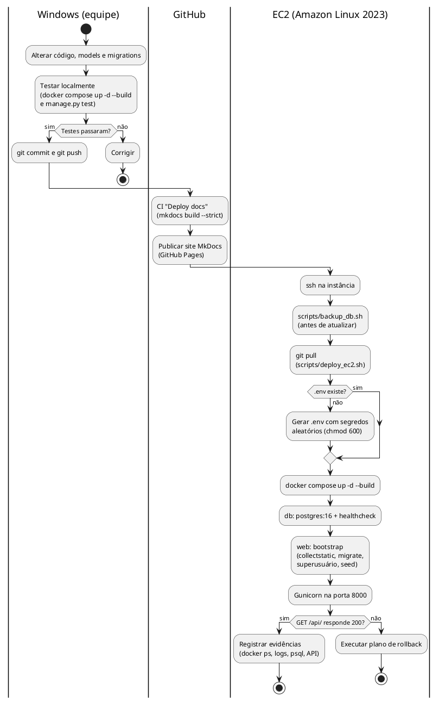

# Modelo de Design — Estratégias de Deploy e Atividades (v1.0)

**Projeto**: Lavoura Inteligente — Rastreabilidade Agrícola e Conformidade EUDR 
**Fase**: Transição 
**Release**: 1 (AP2) 
**Status**: Em revisão

## 1. Objetivo

Registrar as estratégias de implantação avaliadas, a escolhida para a Release 1, as
atividades do deploy realizado, a estimativa de tempo e de custo e o plano de rollback.

## 2. Contexto

Na AP1 a API Django usava SQLite e rodava no **Elastic Beanstalk**. O cliente pediu para
retirar a dependência do Beanstalk e do SQLite, executar a solução em **EC2 com Docker
Compose** (containers `web` e `db`) e persistir os dados em **PostgreSQL** com volume e
segredos fora do Git.

## 3. Estratégias avaliadas

| # | Estratégia | Prós | Contras | Custo mensal de referência* |
| -- | -- | -- | -- | -- |
| E1 | Elastic Beanstalk + SQLite (AP1) | deploy simples pelo console/CLI | SQLite não suporta várias instâncias nem JSONB/GIN; dependência do Beanstalk; dados perdidos ao recriar a instância | EC2 t3.small ~US$ 15 (+ ALB ~US$ 16 se balanceado) |
| **E2** | **EC2 + Docker Compose (web + PostgreSQL em container)** | mesmo ambiente local e na nuvem; Postgres com JSONB/GIN; custo mínimo; controle total | ponto único de falha; backup e patches manuais | **~US$ 21** (t3.small + EBS 30 GB + IPv4) |
| E3 | EC2 + Docker (web) + Amazon RDS PostgreSQL | backup com PITR, Multi-AZ opcional; web pode escalar | custo maior; sub-rede privada e SG a configurar | ~US$ 35 (E2 + db.t4g.micro + 20 GB) |
| E4 | ECS Fargate + RDS + ALB | sem servidor para administrar; escala automática | maior complexidade (task definition, ECR, ALB); custo fixo do ALB | ~US$ 60+ |
| E5 | Serverless (API Gateway + Lambda + DynamoDB + RDS/PostGIS) | arquitetura-alvo do [Documento de Arquitetura](../Elaboracao/arquitetura.md); paga por uso | reescrita da API; fora do prazo da AP2 | variável; dentro de US$ 1.500 (RNF-CUS-01) |

\* Região us-east-2, on-demand, valores de referência a conferir no AWS Pricing Calculator.

### 3.1. Critérios e decisão

| Critério (peso) | E1 | E2 | E3 | E4 | E5 |
| -- | -- | -- | -- | -- | -- |
| Atende ao pedido do cliente (EC2 + Compose + Postgres) (3) | 0 | 3 | 2 | 1 | 0 |
| Prazo da AP2 (3) | 3 | 3 | 2 | 1 | 0 |
| Custo (2) | 2 | 3 | 2 | 1 | 2 |
| Durabilidade e recuperação (2) | 0 | 1 | 3 | 3 | 3 |
| Escalabilidade (1) | 1 | 1 | 2 | 3 | 3 |
| **Total (máx. 33)** | **14** | **27** | **24** | **17** | **13** |

**Decisão**: **E2 — EC2 + Docker Compose com PostgreSQL em container**. Ela cumpre todos
os requisitos da AP2 com o menor custo e reproduz na EC2 o mesmo ambiente testado no
Windows. A **E3 (RDS)** fica registrada como próxima evolução, para atingir o RPO de 15 min
e a disponibilidade de 99,9% (ver [dimrbd.md](../Elaboracao/dimrbd.md), seção 6).

## 4. Diagrama de atividades do deploy realizado

## 5. Estimativa de tempo

| Atividade | Primeiro deploy | Atualização |
| -- | -- | -- |
| Criar instância, Security Group e Elastic IP | 15 min | — |
| Instalar Docker, Git, Compose e Buildx (`deploy_ec2.sh`, passos 1 e 2) | 5 min | — |
| Clonar ou atualizar o código | 1 min | < 1 min |
| Build da imagem e download do `postgres:16` | 3–5 min | 1–2 min (cache) |
| `bootstrap` + subida do Gunicorn | < 1 min | < 1 min |
| Verificação e evidências | 10 min | 2 min |
| **Total** | **~35 min** | **~5 min** |

## 6. Estimativa de custo mensal (Release 1)

| Item | Quantidade | Custo de referência* |
| -- | -- | -- |
| EC2 t3.small on-demand | 730 h | US$ 15,18 |
| EBS gp3 | 30 GB | US$ 2,40 |
| IPv4 público / Elastic IP associado | 730 h × US$ 0,005 | US$ 3,65 |
| S3 para backups | ~2 GB | US$ 0,05 |
| Transferência de saída | < 100 GB (faixa gratuita) | US$ 0,00 |
| **Total** | | **~US$ 21,28/mês** |

Fica bem abaixo do orçamento de US$ 1.500/mês (RNF-CUS-01). Com uma t3.micro do Free
Tier, o custo da instância cai a zero durante a elegibilidade.

\* us-east-2, on-demand, valores de referência a confirmar no AWS Pricing Calculator.

## 7. Plano de rollback

| Situação | Ação | Tempo alvo |
| -- | -- | -- |
| Build falhou | Nada muda: os containers anteriores continuam rodando. Corrigir no Windows e fazer novo push. | 0 min de indisponibilidade |
| Nova versão sobe mas a API falha | `git log --oneline` → `git checkout <commit_estável>` → `docker compose up -d --build` | < 5 min (RNF-MAN-02) |
| Migration corrompeu ou perdeu dados | Parar o web, restaurar o dump feito antes do deploy (procedimento em [dimrbd.md](../Elaboracao/dimrbd.md), 5.2) e voltar ao commit anterior | < 30 min |
| Instância perdida | Nova EC2 + `deploy_ec2.sh` + restaurar o último dump do S3 | < 1 h |

Regras: **sempre** rodar `scripts/backup_db.sh` antes de uma atualização com migration e
**nunca** usar `docker compose down -v` na EC2. Depois de um rollback com `git checkout`,
voltar para `main` com `git checkout main` quando a correção for publicada.

## 8. Critérios de aceite da Transição

Itens marcados foram verificados no ambiente de teste da equipe; os demais são marcados
após o deploy na EC2.

- [x] `.env` fora do Git; `.env.example` versionado sem senhas reais.
- [x] 10 testes automatizados passando em `python manage.py test`.
- [x] PostgreSQL sem porta publicada (serviço `db` sem `ports` no Compose).
- [x] Dados persistem depois de `docker compose down` e `up -d` (teste local).
- [ ] API no IP público da EC2 (`http://<IP_PUBLICO_EC2>:8000/api/`) e Django Admin com estilo.
- [ ] Security Group só com 22 e 8000.
- [ ] Persistência comprovada na EC2 e evidências (prints) anexadas ao README.

## 9. Histórico e aprovação

| Versão | Data | Status | Descrição | Autor(es) |
| -- | -- | -- | -- | -- |
| 1.0 | 10/11/2026 | Em revisão | Estratégias avaliadas, decisão por EC2 + Docker Compose + PostgreSQL, atividades, custo e rollback. | Equipe do projeto |

| Papel aprovador | Nome | Data | Decisão |
| -- | -- | -- | -- |
| Arquiteto de Soluções | | | Pendente |
| Professor responsável | | | Pendente |
