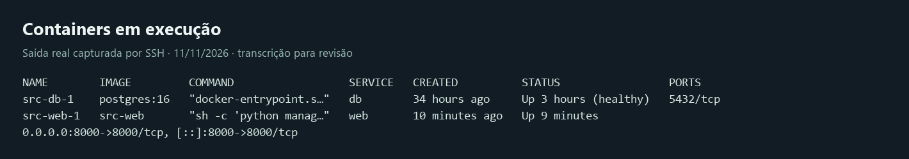
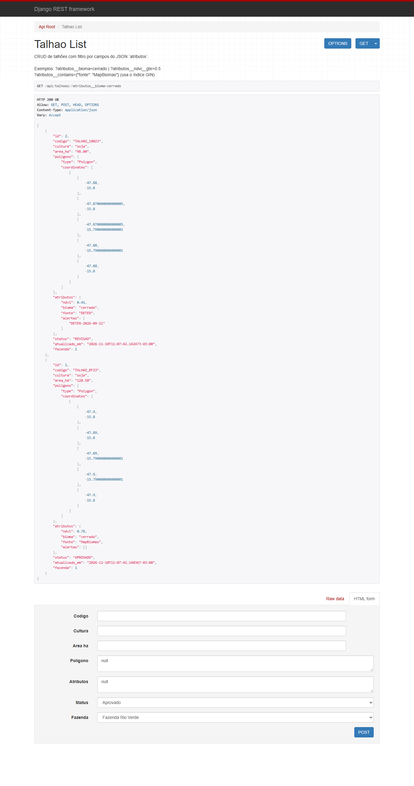
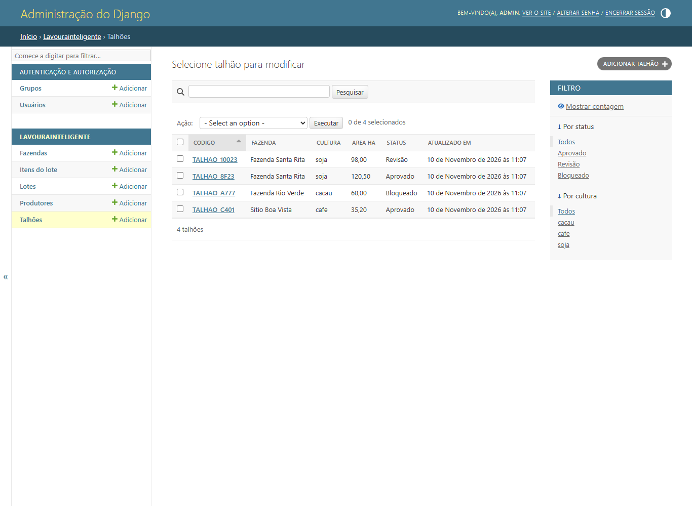
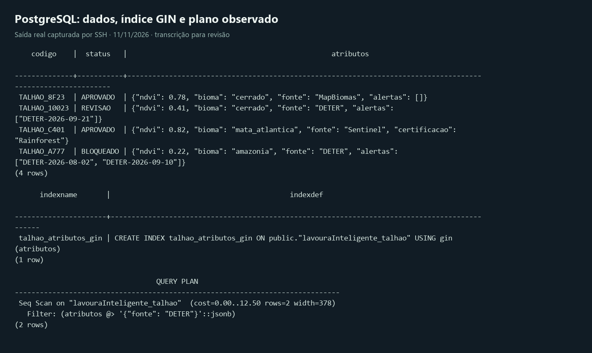
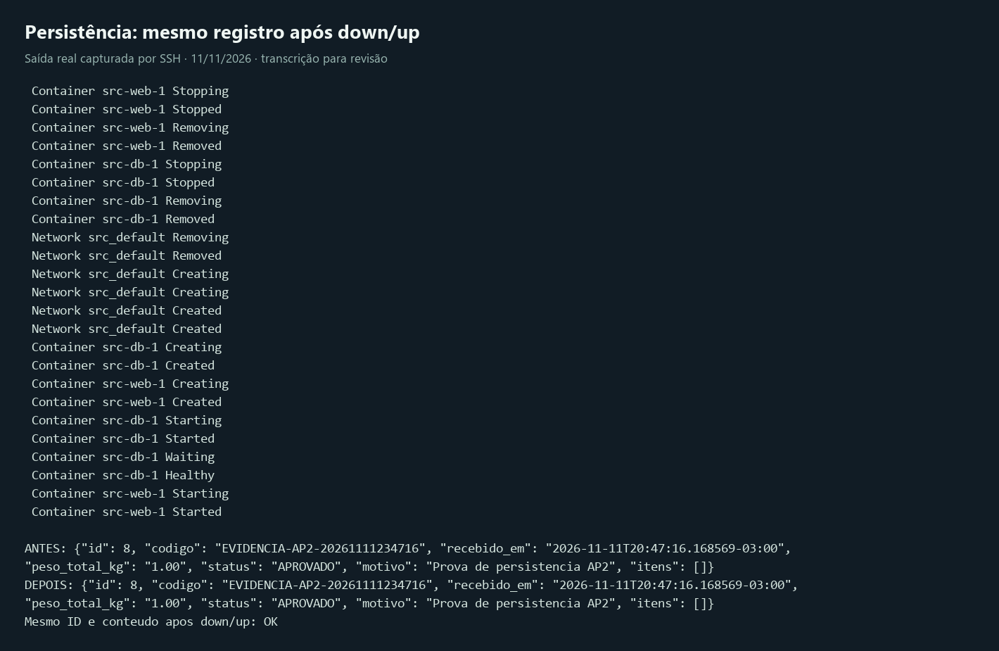
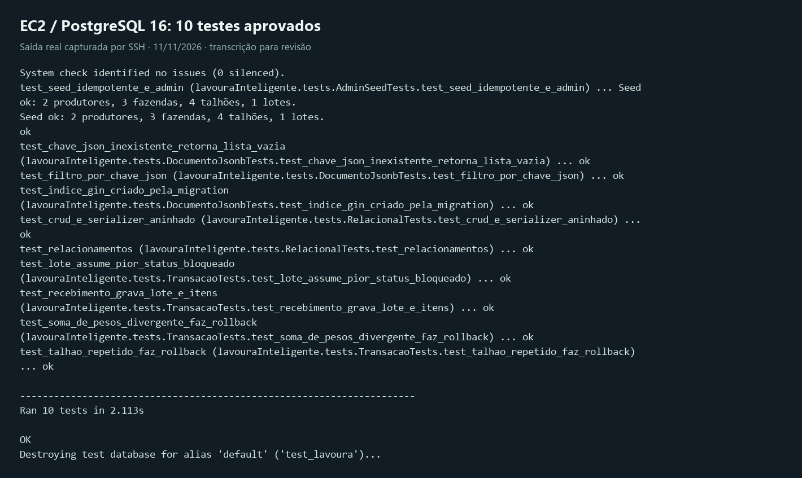
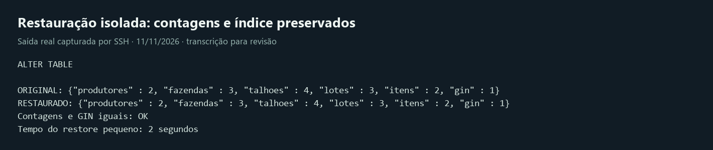

# Validação da AP2 — Raízes

**Data:** 11/11/2026, America/Sao_Paulo. **Situação:** publicação e deploy autorizados em 11/11/2026. As evidências anteriores e atuais são identificadas separadamente.

Raízes é o nome do produto informado pelo responsável; o case da disciplina é Lavoura Inteligente. O app técnico `lavouraInteligente`, seus modelos e tabelas permanecem identificáveis. A proposta renomeia somente o pacote de configuração `conifg` para `raizes_config`.

## Estado real da EC2

- Amazon Linux 2023, t3.small, us-east-2, disco EBS de 8 GiB.
- Diretório ativo: `/home/ec2-user/PC_ADS_26.2_8001_II`; a cópia em `~/lavouraInteligente/PC_ADS_26.2_8001_II` é antiga.
- Containers: PostgreSQL 16 healthy, porta 5432 sem publicação; Django/Gunicorn na porta 8000.
- IP atual: `18.117.197.72`. Hosts e CSRF do `.env` corrigidos, segredos preservados, arquivo com permissão 600.
- API: <http://18.117.197.72:8000/api/>. Admin: <http://18.117.197.72:8000/admin/>.
- Limpeza de cache de instaladores VSIX e cache DNF; projetos, extensões instaladas, containers e volumes preservados. Antes: 99% do disco ocupado; depois: cerca de 699 MiB livres. Ampliar o disco continua uma recomendação a avaliar, não uma mudança executada.

## Critérios A e B

| Critério | Evidência / situação |
| -- | -- |
| A1 | Nome Raízes, portal e pacote `raizes_config` implantados na EC2 em 11/11/2026. |
| A2–A3 | Cinco models, FKs, associação LoteTalhao, JSONB e índice GIN por migration verificados. |
| A4 | Endpoint de recebimento com 201; dois casos de rollback 409 sem alteração de contagens. |
| A5 | CRUD completo dos cinco recursos, inclusive PUT/PATCH/DELETE, aninhamento e filtro JSON testados por HTTP externo. |
| A6 | Login HTTP real do Admin com CSRF e tabela de talhões verificados. Snapshot HTML sanitizado para captura, sem tokens. |
| A7–A8 | `.env` privado, DEBUG desativado, configuração por ambiente, seed e testes. Sem transferência do `.env` para a revisão. |
| B1 | SO e ferramentas verificados. SG identificado como `launch-wizard-2`; regras de entrada ainda dependem do console AWS. |
| B2–B4 | Compose com web/db, volume nomeado, healthcheck/depends_on; psycopg e configuração PostgreSQL; `.env` ignorado. |
| B5 | Proposta preparada e testada no Windows. Commit/push/pull/deploy autorizados; ver guia de integrações. |
| B6 | API pública e Admin funcionais após correção do IP. |
| B7 | Lote de demonstração conservou ID e conteúdo após down/up, sem apagar volume. |
| B8 | Imagens e logs de validações reais; publicação autorizada pelo responsável. |

## Testes e observações

| Ambiente | Resultado |
| -- | -- |
| EC2, PostgreSQL 16, versão já implantada | 10 testes aprovados; migrations aplicadas; models sem migration pendente. |
| Windows, PostgreSQL 18 isolado, proposta local | 40 testes aprovados, incluindo CRUD e contratos do portal (sessão/CSRF, revisão, balança, vistorias, arquivos, exportação). |
| HTTP público a partir do Windows | CRUD, filtro JSON, aninhamento, recebimento e rollback aprovados; registros temporários removidos. |
| Latência de demonstração | 20 GETs sequenciais: p50 310,3 ms, p95 339,6 ms. Sem teste sustentado de carga ou volumetria de produção. |
| Restore isolado | 2 produtores, 3 fazendas, 4 talhões, 3 lotes, 2 itens e 1 índice GIN, iguais ao banco original no momento da captura. Restore pequeno em 2 s; não é prova de RTO de uma instância perdida. |

O otimizador escolhe o plano conforme consulta e volume. A existência do índice GIN foi comprovada; não se afirma que toda consulta usa o índice.

## Evidências

As imagens de logs são transcrições das saídas reais capturadas via SSH. A imagem da API vem de uma navegação pública. O Admin é um snapshot de HTML após login HTTP real na EC2, sanitizado e renderizado localmente com seus estáticos públicos.

## O que permanece pendente

1. Registrar o deploy autorizado e as verificações AWS no guia de integrações.
2. Conferência no console AWS das regras de entrada do SG: SSH restrito ao IP de administração, API 8000 e nenhuma exposição PostgreSQL.
3. Política contínua de retenção: o responsável autorizou uma única cópia S3, restaurada em banco separado. O cron diário permanece somente local, por escolha expressa. A instância deve estar ligada no horário agendado.
4. Confirmação dos membros e professor no repositório, commits individuais reais, aprovações e apresentação da equipe. Esta revisão não simula aprovação ou autoria de terceiros.
5. Validação dos custos e elegibilidade de Free Tier na conta; valores documentados são estimativas, sem acesso à fatura ou ao AWS Pricing Calculator autenticado.

O [roteiro oficial da AP2](https://jonh-carvalho.github.io/PC_ADS_26.2_8001/Avalia/ap2/) exige API, Admin, PostgreSQL e documentação. A interface do Apollo enviada como exemplo ilustra apresentação; não comprova publicamente os critérios internos do projeto da outra equipe e não muda o domínio nem os requisitos do Raízes.

## Revisão e responsabilidade

Preparação técnica assistida por automação, solicitada pelo responsável do projeto. Aprovação do responsável, da equipe e do professor: **ainda não registrada**. Nenhuma aprovação acadêmica é inferida de testes técnicos.

## Atualização do frontend e integrações

Portal próprio na raiz `/`, com migrations `0002` e `0003`, volume `media`, consulta
INPE/DETER e adaptadores AWS. O [guia de integrações](../Construcao/integracoes_aws_ambientais.md)
registra os limites e as verificações da implantação autorizada.
